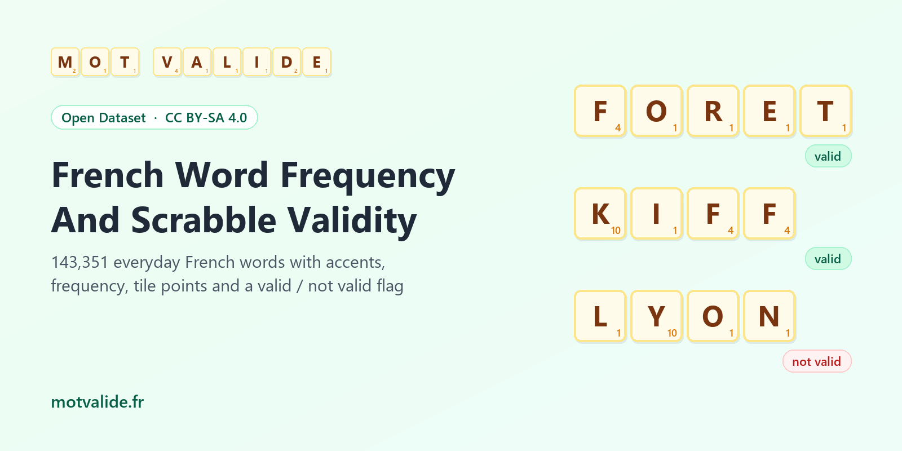

# French Word Frequency And Scrabble Validity

**English first, version française complète plus bas.** The CSV files are in [`data/`](data/).

## Is "Forêt" A Valid Scrabble Word? What About "Paris"?

*Forêt* is valid, played as FORET because tiles carry no accents. *Paris* is valid too, but only as the plural of *pari* (a bet), never as the city. *Lyon* is not valid at all. *Particulièrement* is a perfectly common word that you will never play, because it has 16 letters and the board has 15 squares.

This dataset answers that question for **143,351 French words people actually write**. Each word comes with its frequency in real French text, the spelling you would use on the board, its face value in points, and whether it is a valid Scrabble word. When it is not, the dataset says why.

It is the first French dataset on Kaggle that links everyday word frequency to Scrabble validity. English has had word lists like this for years. French had nothing comparable.

## What's Inside

| File | Rows | What it holds |
|---|---|---|
| `french_words_frequency_scrabble.csv` | 143,351 | One row per written spelling, sorted from most to least frequent |
| `validity_by_frequency_band.csv` | 6 | Share of valid words, and share of running text they cover, per frequency band |
| `validity_by_length.csv` | 23 | Validity by word length, and how many valid words of each length are ever written |
| `not_valid_reasons.csv` | 8 | Why real French words get refused, with the most frequent examples |

**Main file columns.** `word` (as written, with accents), `scrabble_form` (uppercase, no accents, Œ split into OE), `length`, `zipf_frequency`, `per_million_words`, `frequency_rank`, `frequency_band`, `scrabble_valid` (1 or 0), `scrabble_points` (sum of tile values, no board bonus), `not_valid_reason`, `not_valid_category` (noun, verb, adjective…), `has_accent`, `spellings_with_same_form`, `motvalide_url`.

## Where The Data Comes From

Three sources are joined on the letters of each word.

1. **Frequency** comes from [wordfreq](https://github.com/rspeer/wordfreq) (Robyn Speer, CC BY-SA 4.0), which merges French subtitles, Wikipedia, news, books, web pages and social media into one frequency figure per word. It reflects usage up to about 2021. The value is given on the Zipf scale, where 6 means once every thousand words, 3 means once per million, and 1 is the floor of the list.
2. **Scrabble validity** comes from the word list behind [Mot Valide](https://www.motvalide.fr/), a free French Scrabble word checker holding 412,101 valid word forms.
3. **Reasons for refusal** come from a lexicon of French words that are not playable, built for Mot Valide from [Morphalou 3.1](https://www.ortolang.fr/market/lexicons/morphalou) (CNRS / ATILF, LGPL-LR) and Wiktionary extracts ([kaikki.org](https://kaikki.org/), CC BY-SA). It tags each word as a proper noun, an abbreviation, slang, a dated form and so on.

**What gets in.** A word is listed when it shows up in real French usage and a French dictionary knows it. Each spelling is mapped to the letters you would place on the board, and less frequent spellings of the same letters are kept only when they are genuine words, not typing shortcuts or misspellings. Every refused word gets one main reason, based on dictionary tags and a few simple checks.

The words that are valid but never written, about 294,000 of them, are not listed here. Only their counts appear, in `validity_by_length.csv`.

## Patterns, And Why They Happen

**1. Almost every word you read is playable.** Weighted by frequency, 96.6% of running French text is made of valid Scrabble words. The 800 most common words (Zipf 5 and up) cover 69% of any text, and 98.6% of them are valid. The 11 exceptions are revealing. They are proper nouns (*France*, *Europe*, *Québec*, *Allemagne*, *Afrique*, and *françois*, mostly the first name), abbreviations (*etc*, *II*, *OK*), the English *new*, and the elided *qu'*, which never stands alone.

**2. Proper nouns are the first reason for refusal.** They account for 51% of the 18,897 refused words. The rules ban them, which is why *Lyon* is out while *Paris* survives as a common noun.

**3. The board has 15 squares.** Validity sits above 90% for every length from 8 to 15 letters, then collapses to 49% at 16 letters, 15% at 17 and zero from 19. The 1,219 long words refused include *particulièrement*, *considérablement* and *télécommunications*.

**4. Short strings are a minefield.** Only 23% of two-letter spellings and 36% of three-letter ones are valid, because short tokens are full of abbreviations (*km*, *tv*, *mm*), interjections and English words (*hey*, *big*, *end*). Yet all 81 valid two-letter words do appear in real usage.

**5. Accents disappear on the board.** A third of the rows carry an accent, and 6,322 board spellings stand for two or more written words. PECHE alone covers *pêche*, *péché*, *pêché* and *pèche*. Any game or checker that works on French text has to fold these together.

**6. Common words are cheap.** Valid words average 8.5 points in the very common band and 14.4 in the rare band. Frequent words are short and built from one-point letters (E, A, S, I, N, T, R, U, L, O). The high scorers people still write often are *psychologique* (37), *physiquement* (34), *sympathique* (33), *joyeux* (31), *hockey* and *jazz* (29).

**7. Most valid words are never written.** All two-letter words show up in usage, but only 76% of valid five-letter words, 31% of nine-letter ones and 13% of fifteen-letter ones do. Overall, 118,303 of the 412,101 valid forms (29%) appear in wordfreq. The rest is mostly conjugation, such as *abonnassiez* or *déconfiriez*, which is perfectly playable and almost never written.

## Caveats

- **Frequency is not a dictionary.** wordfreq counts what people write, slang and typos included, and its data stops around 2021, so recent words like *kiff* (Zipf 3.06) may be under-counted.
- **One frequency per spelling, not per meaning.** *Paris* the city and *paris* the bets share one frequency figure, and here the city dominates.
- **The "other" reason is a mixed bag.** It holds elided forms (*qu*, *jusqu*), rare nouns not in the Scrabble list, and some first names the source lexicon tags as common nouns (*stéphane*).
- **Face value only.** `scrabble_points` ignores letter and word multipliers and the 50-point bonus for playing all seven tiles.
- **Validity can change.** French Scrabble word lists are revised every few years. This file reflects Mot Valide's list in October 2026.

## Ideas

- Build a French Wordle or Sutom word list. Filter `scrabble_valid == 1`, a length, and `zipf_frequency >= 3` for words players will know.
- Train a model that guesses validity from letter patterns, and test it on the rare band.
- Study accent ambiguity with `spellings_with_same_form` for spell-checking or search.
- Pick teaching vocabulary that is both common and high-scoring for young players.

A starter notebook, [How Much French Can You Play In Scrabble?](https://www.kaggle.com/code/cuivrax/how-much-french-can-you-play-in-scrabble), walks through every pattern above with charts. The same dataset is on [Hugging Face](https://huggingface.co/datasets/verbarium/french-word-frequency-scrabble-validity), with a free [French Scrabble Word Checker](https://huggingface.co/spaces/verbarium/french-scrabble-word-checker) Space and a [Google Colab notebook](https://colab.research.google.com/drive/1KWYTdrSF1uhFIpYOKle0vLvfgfSgS0yV).

## About

Compiled by [Mot Valide](https://www.motvalide.fr/), a free French Scrabble word checker. Every row links to its word page (`motvalide_url`), for example [FORET](https://www.motvalide.fr/mot/foret) or [PARIS](https://www.motvalide.fr/mot/paris), with points, anagrams and related words. You can also browse the [valid two-letter words](https://www.motvalide.fr/mots/2-lettres), solve a rack with the [anagram finder](https://www.motvalide.fr/anagrammeur) or check the [rules of Scrabble](https://www.motvalide.fr/regles-scrabble).

If you use the data, please credit "Mot Valide (motvalide.fr), frequency data from wordfreq". The dataset is shared under CC BY-SA 4.0 because wordfreq uses the same license. Scrabble is a trademark of its respective owners. Mot Valide is an independent site, not affiliated with them.

---

## Version Française

### « Forêt » Est-Il Valide Au Scrabble ? Et « Paris » ?

*Forêt* est valide, et se joue FORET puisque les jetons n'ont pas d'accent. *Paris* l'est aussi, mais seulement comme pluriel de *pari*, jamais comme la ville. *Lyon* n'est pas valide du tout. Quant à *particulièrement*, c'est un mot très courant que vous ne poserez jamais. Il a 16 lettres et le plateau n'a que 15 cases.

Ce jeu de données répond à cette question pour **143 351 mots français réellement écrits**. Chaque mot est accompagné de sa fréquence d'usage, de son écriture sur le plateau, de sa valeur en points et de sa validité au Scrabble. S'il n'est pas valide, le dataset dit pourquoi.

C'est le premier jeu de données français sur Kaggle qui relie la fréquence des mots à leur validité au Scrabble. L'anglais dispose de ce genre de liste depuis longtemps, le français de rien d'équivalent.

### Contenu

| Fichier | Lignes | Contenu |
|---|---|---|
| `french_words_frequency_scrabble.csv` | 143 351 | Une ligne par orthographe, du mot le plus fréquent au plus rare |
| `validity_by_frequency_band.csv` | 6 | Part de mots valides et part du texte courant couverte, par tranche de fréquence |
| `validity_by_length.csv` | 23 | Validité par longueur, et part des mots valides de chaque longueur réellement écrits |
| `not_valid_reasons.csv` | 8 | Les raisons de refus des vrais mots français, avec les exemples les plus fréquents |

### D'où Viennent Les Données

Trois sources sont croisées sur les lettres de chaque mot.

1. **La fréquence** vient de [wordfreq](https://github.com/rspeer/wordfreq) (Robyn Speer, CC BY-SA 4.0). Il fusionne sous-titres, Wikipédia, presse, livres, pages web et réseaux sociaux en une fréquence par mot, à jour jusqu'à 2021 environ. Elle est exprimée sur l'échelle de Zipf. 6 signifie une fois tous les mille mots, 3 une fois par million, et 1 marque le plancher de la liste.
2. **La validité au Scrabble** vient de la liste de mots de [Mot Valide](https://www.motvalide.fr/), vérificateur de mots gratuit qui compte 412 101 formes valides.
3. **Les raisons de refus** viennent d'un lexique des mots français non jouables construit pour Mot Valide à partir de [Morphalou 3.1](https://www.ortolang.fr/market/lexicons/morphalou) (CNRS / ATILF, LGPL-LR) et d'extraits du Wiktionnaire ([kaikki.org](https://kaikki.org/), CC BY-SA). Il indique si un mot est un nom propre, une abréviation, de l'argot, une forme vieillie, etc.

**Ce qui est retenu.** Un mot figure ici s'il apparaît dans l'usage réel du français et qu'un dictionnaire de la langue française le connaît. Chaque orthographe est ramenée aux lettres posées sur le plateau, et les variantes plus rares des mêmes lettres ne sont gardées que si ce sont de vrais mots, pas des raccourcis de saisie ni des fautes. Chaque mot refusé reçoit une raison principale, tirée des indications du dictionnaire et de quelques vérifications simples.

Les quelque 294 000 mots valides que personne n'écrit ne figurent pas ici. Seuls leurs effectifs apparaissent, dans `validity_by_length.csv`.

### Ce Que Montrent Les Données, Et Pourquoi

**1. Presque tout ce qu'on lit est jouable.** Pondéré par la fréquence, 96,6 % du texte français courant est composé de mots valides au Scrabble. Les 800 mots les plus courants couvrent 69 % de n'importe quel texte, et 98,6 % d'entre eux sont valides. Les 11 exceptions sont parlantes. Ce sont des noms propres (*France*, *Europe*, *Québec*, *Allemagne*, *Afrique*, et *françois*, surtout le prénom), des abréviations (*etc*, *II*, *OK*), l'anglais *new* et le *qu'* élidé, qui n'existe jamais seul.

**2. Les noms propres sont la première cause de refus.** Ils représentent 51 % des 18 897 mots refusés. La règle les interdit, d'où *Lyon* refusé alors que *Paris* passe comme nom commun.

**3. Le plateau a 15 cases.** La validité dépasse 90 % pour toutes les longueurs de 8 à 15 lettres, puis s'effondre à 49 % à 16 lettres, 15 % à 17, et zéro à partir de 19. Les 1 219 mots trop longs refusés incluent *particulièrement*, *considérablement* et *télécommunications*.

**4. Les mots très courts sont un piège.** Seules 23 % des chaînes de deux lettres et 36 % de celles de trois lettres sont valides, car on y trouve beaucoup d'abréviations (*km*, *tv*, *mm*), d'interjections et de mots anglais (*hey*, *big*, *end*). Pourtant, les 81 mots valides de deux lettres apparaissent tous dans l'usage réel.

**5. Les accents disparaissent sur le plateau.** Un tiers des lignes portent un accent, et 6 322 écritures de plateau correspondent à au moins deux mots écrits. PECHE couvre à lui seul *pêche*, *péché*, *pêché* et *pèche*.

**6. Les mots courants rapportent peu.** Les mots valides valent en moyenne 8,5 points dans la tranche très courante, contre 14,4 dans la tranche rare. Les mots fréquents sont courts et faits de lettres à un point. Parmi les mots courants qui rapportent gros, on trouve *psychologique* (37), *physiquement* (34), *sympathique* (33), *joyeux* (31), *hockey* et *jazz* (29).

**7. La plupart des mots valides ne sont jamais écrits.** Tous les mots de deux lettres apparaissent dans l'usage, contre 76 % des mots valides de cinq lettres, 31 % de ceux de neuf lettres et 13 % de ceux de quinze lettres. Au total, 118 303 des 412 101 formes valides (29 %) figurent dans wordfreq. Le reste, ce sont surtout des conjugaisons comme *abonnassiez* ou *déconfiriez*, parfaitement jouables et presque jamais écrites.

### Limites

- **La fréquence n'est pas un dictionnaire.** wordfreq compte ce qui s'écrit, argot et fautes compris, et ses données s'arrêtent vers 2021. Des mots récents comme *kiff* (Zipf 3,06) peuvent être sous-estimés.
- **Une fréquence par orthographe, pas par sens.** *Paris* la ville et *paris* les mises partagent la même fréquence, dominée ici par la ville.
- **La raison « other » est un fourre-tout.** Elle regroupe les formes élidées (*qu*, *jusqu*), des noms rares absents de la liste du Scrabble et quelques prénoms que le lexique source classe comme noms communs (*stéphane*).
- **Valeur faciale uniquement.** `scrabble_points` ignore les cases multiplicatrices et la prime de 50 points pour un scrabble.
- **La validité évolue.** Les listes de mots du Scrabble français sont révisées tous les quelques années. Ce fichier reflète la liste de Mot Valide en octobre 2026.

### À Propos

Réalisé par [Mot Valide](https://www.motvalide.fr/), vérificateur gratuit de mots pour le Scrabble. Chaque ligne renvoie à la page du mot (`motvalide_url`), par exemple [FORET](https://www.motvalide.fr/mot/foret) ou [PARIS](https://www.motvalide.fr/mot/paris), avec ses points, ses anagrammes et les mots proches. Vous pouvez aussi consulter les [mots valides de deux lettres](https://www.motvalide.fr/mots/2-lettres), résoudre un tirage avec l'[anagrammeur](https://www.motvalide.fr/anagrammeur) ou relire les [règles du Scrabble](https://www.motvalide.fr/regles-scrabble). Le jeu de données existe aussi sur [Hugging Face](https://huggingface.co/datasets/verbarium/french-word-frequency-scrabble-validity), avec un [vérificateur de mots](https://huggingface.co/spaces/verbarium/french-scrabble-word-checker) gratuit et un [carnet Google Colab](https://colab.research.google.com/drive/1KWYTdrSF1uhFIpYOKle0vLvfgfSgS0yV).

Si vous utilisez ces données, merci de citer « Mot Valide (motvalide.fr), fréquences issues de wordfreq ». Le jeu de données est sous licence CC BY-SA 4.0, comme wordfreq. Scrabble est une marque déposée de ses propriétaires respectifs. Mot Valide est un site indépendant, sans lien avec eux.

---

**Part of [French Word Dictionaries And Word Lists](https://github.com/verbarium/french-word-dictionaries)** by Verbarium. Data by [Mot Valide](https://www.motvalide.fr/). Also on [Kaggle](https://www.kaggle.com/datasets/cuivrax/french-word-frequency-scrabble-validity) and [Hugging Face](https://huggingface.co/datasets/verbarium/french-word-frequency-scrabble-validity).
